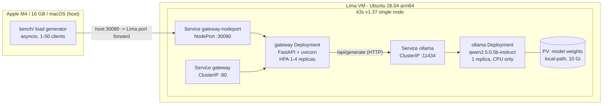

# local-llm-k8s

A single-node Kubernetes cluster on a Mac, serving a small open model, with a
measured benchmark and a cost model that says when self-hosting beats an API.

**Not** a claim of savings. The deliverable is the number: at what monthly token
volume does self-hosting win, on which hardware, at what utilisation — and when
it loses.

> Status: CPU-only, one node, no GPU. The absolute throughput does not transfer
> to a GPU cluster. Read [What this does not prove](#what-this-does-not-prove)
> before quoting any number from this repo.

## Architecture



Everything runs on the Mac. No cloud account, no Docker Desktop, no GPU, no
spend. Lima forwards the k3s API (6443) and the gateway NodePort (30080) to the
host; the load generator talks to the real Service path, not a port-forward
through the API server.

## Stack

| Layer | Choice | Why |
|---|---|---|
| VM | Lima 2.x, `vz` driver, Ubuntu 26.04 LTS arm64, 4 vCPU / 6 GiB / 20 GiB | native Apple virtualisation, no Docker Desktop |
| Cluster | k3s v1.37 (single node, traefik disabled) | real Kubernetes, small enough for 6 GiB |
| Serving | Ollama `ollama/ollama:0.40.14`, `qwen2.5:0.5b-instruct` | CPU-friendly, arm64 image, OpenAI-ish API |
| Storage | `local-path` PVC (10 Gi) | model survives pod restarts |
| App | FastAPI + uvicorn + httpx, non-root, read-only rootfs | small, testable, no state |
| Autoscaling | HPA v2 on gateway CPU (min 1, max 4) | scale the stateless tier, not Ollama |
| CI | kubeconform, pytest, kind smoke test on GitHub Actions | the Mac has no Docker; the runner does |

## Quickstart

Requires an Apple silicon Mac with ~15 GB free disk. No Homebrew, no `sudo`, no
paid services.

```bash
git clone https://github.com/devops-gm88/local-llm-k8s
cd local-llm-k8s

make up        # downloads limactl/kubectl, creates the VM, installs k3s,
               # builds the gateway image, pulls the model, deploys
kubectl get nodes          # -> Ready
make demo                  # one question through the gateway

make bench     # 1/2/4 gateway replicas x 10/50 clients -> bench/results.*
make cost      # break-even table + chart from the measured results
make down      # delete workloads; `make stop` shuts the VM down
```

`make up` takes 10-15 minutes the first time (Ubuntu image, k3s, a 2.8 GB
Ollama image, a 0.4 GB model). Later runs are under a minute.

If a step fails, open [docs/RESTART_CHEATSHEET.html](docs/RESTART_CHEATSHEET.html).
It has the start/stop steps, a symptom table, and the one Ubuntu 26.04 trap.

## Results

<!-- BENCH:START -->
Measured 2026-11-04T19:21:53+00:00 on `macOS-26.5.2-arm64-arm-64bit-Mach-O` (`arm64`), k3s `v1.37.2+k3s1`, model `qwen2.5:0.5b-instruct`, prompt capped at 64 output tokens. Warm-up excluded. 120 requests per cell.

| gateway replicas | concurrent clients | p50 (ms) | p95 (ms) | p99 (ms) | output tok/s | error rate |
|---:|---:|---:|---:|---:|---:|---:|
| 1 | 10 | 4682.7 | 5297.8 | 6795.3 | 104.76 | 0.0% |
| 1 | 50 | 20147.5 | 22375.7 | 22476.7 | 106.93 | 0.0% |
| 2 | 10 | 4753.7 | 6645.8 | 6900.7 | 97.27 | 0.0% |
| 2 | 50 | 20657.2 | 22697.5 | 22762.7 | 105.04 | 0.0% |
| 4 | 10 | 3702.5 | 5036.7 | 5140.3 | 107.09 | 0.0% |
| 4 | 50 | 20186.9 | 22250.9 | 22479.2 | 106.09 | 0.0% |

- HPA: under 400 requests at 50 concurrent clients it scaled 1 -> **2 replicas** after **133.0 s**, then stopped: per-pod CPU fell back below the target once the second pod was added, because the gateway is not the bottleneck.
- Cold start: gateway pod Ready in **4.28 s**; Ollama pod restart (model re-verified from the PVC) in **48.87 s**; first answer after the model reload in **1966.0 ms**.
- Best sustained throughput in the grid: **107.09 output tokens/second** (spread across all six cells: 97.27-107.09 tok/s). **Adding gateway replicas does not add throughput** - Ollama is the bottleneck and it is not horizontally scalable here.
<!-- BENCH:END -->

## Break-even

<!-- COST:START -->
Measured CPU throughput: **107.09 output tokens/second** (4 replica, 10 clients). Measured input/output token mix: 55% input / 45% output.

Comparator: **OpenAI gpt-6-luna** at its list price (`cost/assumptions.json`, fetched 2026-11-04).

| self-host scenario | monthly cost (USD) | break-even tokens/month | utilisation needed |
|---|---:|---:|---:|
| measured CPU-only (this Mac, via Lima VM) | 71 | 250,709,723 | 90% |
| rented L4 24GB (RunPod, 730 h/month) | 385 | 1,367,778,566 | 53% |
| owned GPU box ($2,500 capex, 36 months) | 129 | 457,381,121 | 18% |

Sunk-cost view: with the Mac already owned, the marginal cost of serving is electricity only - about **$3.32/month**. That displaces an API bill for roughly 11,781,405 tokens/month at OpenAI gpt-6-luna prices, so the whole saving is capped at a few dollars a month and it ties up the machine you work on.

> The savings case is a GPU you already own or a rented node kept busy. CPU-only inference on a laptop is not cheaper than an API once the hardware is counted.

Sensitivity: the GPU throughput is **assumed, not measured**. `cost/break_even.png` (right panel) and `cost/model_output.json` show the break-even for 200-8,000 tokens/second; it scales linearly.
<!-- COST:END -->

## What this does not prove

- **CPU-only throughput does not transfer to a GPU.** This box has no GPU.
  Latency and tokens/second here are lower and differently shaped than on an
  L4/A10G class node.
- **The model is small (0.5B).** Quality is not comparable to the API models
  used in the price comparison; the comparison is about cost per token, not
  about being the same product.
- **Single-node k3s is not production HA.** No replicas of the control plane,
  no node failure story, no multi-AZ. The project proves the deployment
  pattern, not scale.
- **The cost model is a model.** It uses public list prices (dated in
  `cost/assumptions.json`) and an explicit, unmeasured GPU throughput
  assumption. It is not a quote and it is not a benchmark of a GPU.
- **More gateway replicas do not add throughput here.** That is a measurement,
  not a bug: Ollama holds ~3 of the 4 vCPUs at load and the gateway uses
  7-160m. The gateway tier scales; the model server does not. On a GPU node
  with a batched server (vLLM-style) the curve would look different, and this
  project does not measure that.
- **The HPA had to be retuned to fire.** A conventional 50% CPU target on a
  100m request never triggered, because the gateway is I/O-bound (11-16% CPU
  under 50 concurrent clients). The shipped manifest uses a 50m request and a
  20% target, which scales 1 -> 2 after ~133 s and then stops, because once the
  second pod shares the load per-pod CPU drops below the target. CPU is a weak
  signal for an I/O-bound proxy; in-flight requests or RPS would be the right
  metric, and that needs a metrics adapter this project does not include.
- **The benchmark runs over a host-side port forward.** Lima forwards the
  NodePort (30080) to the host, so the measured path includes that forward.
  It adds a small, roughly constant overhead per request; it does not change
  the shape of the scaling curve.
- **"Cheaper" has two meanings and they disagree.** Counting the hardware, this
  CPU box needs ~90% utilisation, 24/7, to beat the cheapest API model — and it
  cannot run 24/7 while also being the machine you work on. Counting the
  hardware as already sunk, the marginal cost is a few dollars of electricity
  and it does "win" — but only by a few dollars a month, on a 0.5B model, while
  occupying the workstation. Neither reading supports a "huge savings" claim.

## Repo layout

```
manifests/
  base/                 namespace, configmap, ollama, gateway, service, HPA
  local/                real cluster overlay: PVC for weights + NodePort
  kind/                 CI overlay: same manifests, Ollama replaced by a mock
gateway/                FastAPI /ask gateway + pytest suite + Dockerfile
bench/                  asyncio load generator, orchestration, charts
cost/                   assumptions, break-even model, generated table + chart
scripts/                up/deploy/demo/bench/cost, Lima config template
docs/RUNBOOK.md         operating instructions and failure table
docs/RESTART_CHEATSHEET.html  start/stop/repair steps in easy words
.github/workflows/ci.yml  manifests + gateway tests + kind smoke test
```

## Design decisions worth defending

- **Ollama as a Deployment, not a Job or bare Pod.** It has a PVC, probes and
  resource limits, and `Recreate` strategy so two pods never write the weights
  volume at once.
- **The model pull is an init container**, so a restarted pod verifies cached
  weights instead of re-downloading them, and the pod is not Ready until the
  model is present.
- **Readiness checks the model, liveness does not.** A wedged Ollama should
  remove the gateway from the endpoints; it should not restart the gateway.
- **HPA targets the gateway, never Ollama.** The gateway is stateless and
  scales; the model server is the bottleneck and does not. The target is tuned
  from the measured CPU profile rather than copied from a default, and the
  benchmark records the scale-up time it actually produces.
- **The README tables are generated from the committed JSON**, and CI fails if
  they drift (`bench/render_readme.py --check`). The page cannot claim a number
  the data does not contain.

## Licence

MIT. See [LICENSE](LICENSE).
