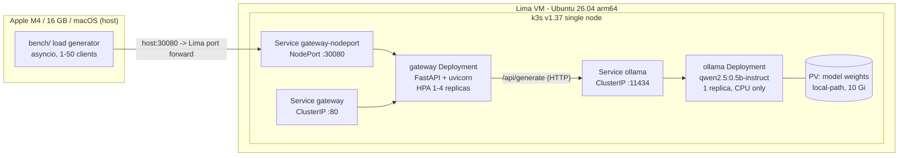

# local-llm-k8s

A single-node Kubernetes cluster on a Mac, serving a small open model, with a
measured benchmark and a cost model that says when self-hosting beats an API.

**Not** a claim of savings. The deliverable is the number: at what monthly token
volume does self-hosting win, on which hardware, at what utilisation — and when
it loses.

> Status: CPU-only, one node, no GPU. The absolute throughput does not transfer
> to a GPU cluster. Read [What this does not prove](#what-this-does-not-prove)
> before quoting any number from this repo.

## Architecture



Everything runs on the Mac. No cloud account, no Docker Desktop, no GPU, no
spend. Lima forwards the k3s API (6443) and the gateway NodePort (30080) to the
host; the load generator talks to the real Service path, not a port-forward
through the API server.

## Stack

| Layer | Choice | Why |
|---|---|---|
| VM | Lima 2.x, `vz` driver, Ubuntu 26.04 LTS arm64, 4 vCPU / 6 GiB / 20 GiB | native Apple virtualisation, no Docker Desktop |
| Cluster | k3s v1.37 (single node, traefik disabled) | real Kubernetes, small enough for 6 GiB |
| Serving | Ollama `ollama/ollama:0.40.14`, `qwen2.5:0.5b-instruct` | CPU-friendly, arm64 image, OpenAI-ish API |
| Storage | `local-path` PVC (10 Gi) | model survives pod restarts |
| App | FastAPI + uvicorn + httpx, non-root, read-only rootfs | small, testable, no state |
| Autoscaling | HPA v2 on gateway CPU (min 1, max 4) | scale the stateless tier, not Ollama |
| CI | kubeconform, pytest, kind smoke test on GitHub Actions | the Mac has no Docker; the runner does |

## Quickstart

Requires an Apple silicon Mac with ~15 GB free disk. No Homebrew, no `sudo`, no
paid services.

```bash
git clone https://github.com/devops-gm88/local-llm-k8s
cd local-llm-k8s

make up        # downloads limactl/kubectl, creates the VM, installs k3s,
               # builds the gateway image, pulls the model, deploys
kubectl get nodes          # -> Ready
make demo                  # one question through the gateway

make bench     # 1/2/4 gateway replicas x 10/50 clients -> bench/results.*
make cost      # break-even table + chart from the measured results
make down      # delete workloads; `make stop` shuts the VM down
```

`make up` takes 10-15 minutes the first time (Ubuntu image, k3s, a 2.8 GB
Ollama image, a 0.4 GB model). Later runs are under a minute.

## Results

_Filled in from `bench/results.json` after the measured run; the README is
checked against the committed JSON._

## Break-even

_Filled in from `cost/break_even.csv` after `make cost`._

## What this does not prove

- **CPU-only throughput does not transfer to a GPU.** This box has no GPU.
  Latency and tokens/second here are lower and differently shaped than on an
  L4/A10G class node.
- **The model is small (0.5B).** Quality is not comparable to the API models
  used in the price comparison; the comparison is about cost per token, not
  about being the same product.
- **Single-node k3s is not production HA.** No replicas of the control plane,
  no node failure story, no multi-AZ. The project proves the deployment
  pattern, not scale.
- **The cost model is a model.** It uses public list prices (dated in
  `cost/assumptions.json`) and an explicit, unmeasured GPU throughput
  assumption. It is not a quote and it is not a benchmark of a GPU.
- **The benchmark runs over a local SSH-tunnelled port forward** (Lima
  forwards 30080 to the host). That adds a small, roughly constant overhead to
  every request; it does not change the shape of the scaling curve.

## Repo layout

```
manifests/
  base/                 namespace, configmap, ollama, gateway, service, HPA
  local/                real cluster overlay: PVC for weights + NodePort
  kind/                 CI overlay: same manifests, Ollama replaced by a mock
gateway/                FastAPI /ask gateway + pytest suite + Dockerfile
bench/                  asyncio load generator, orchestration, charts
cost/                   assumptions, break-even model, generated table + chart
scripts/                up/deploy/demo/bench/cost, Lima config template
docs/RUNBOOK.md         operating instructions and failure table
.github/workflows/ci.yml  manifests + gateway tests + kind smoke test
```

## Design decisions worth defending

- **Ollama as a Deployment, not a Job or bare Pod.** It has a PVC, probes and
  resource limits, and `Recreate` strategy so two pods never write the weights
  volume at once.
- **The model pull is an init container**, so a restarted pod verifies cached
  weights instead of re-downloading them, and the pod is not Ready until the
  model is present.
- **Readiness checks the model, liveness does not.** A wedged Ollama should
  remove the gateway from the endpoints; it should not restart the gateway.
- **HPA targets the gateway, never Ollama.** The gateway is stateless and
  scales; the model server is the bottleneck and does not.

## Licence

MIT. See [LICENSE](LICENSE).
